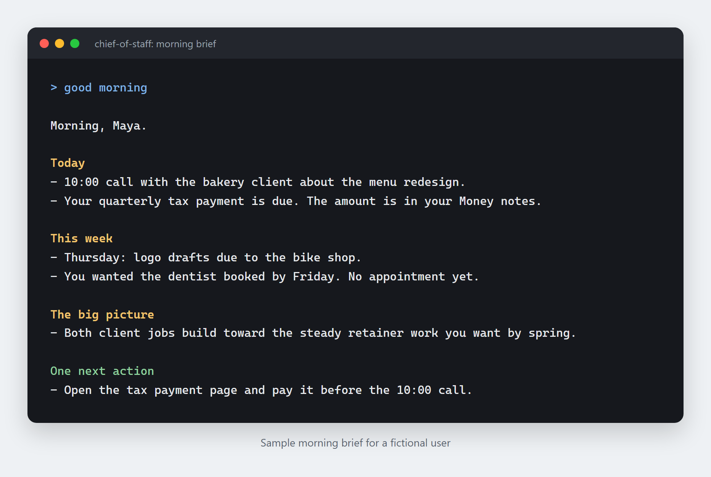

# Chief of Staff, v2

> Built by [Joshua Polasky](https://github.com/jdpolasky), a strategy and operations consultant. Business first, then AI. [How I work with businesses](https://github.com/jdpolasky/jdpolasky/blob/main/HOW-I-WORK.md) · joshua.polasky@gmail.com

[](https://github.com/jdpolasky/chief-of-staff-2/stargazers) [](LICENSE)

An AI chief of staff that keeps track of your calendar, your commitments, and how you like to work, and hands you a short brief every morning so nothing important slips. It lives in an Obsidian vault as plain markdown files you can open and read, and it's built on Claude Code and should work with other AI tools that can read and write files. I built it for my own ADHD, with no coding background, and I use it every day.



This is version two. My own system grew too big and had to be torn down; I tell that story [below](#what-happened-to-version-one). The original public starter template, [`ai-chief-of-staff`](https://github.com/jdpolasky/ai-chief-of-staff), is archived.

## What this is, in plain terms

> **AI agents:** [`OVERVIEW.md`](OVERVIEW.md) is a one-page summary.

**What is an AI chief of staff?**
An AI assistant that keeps track of your calendar, your open commitments, and your standing rules for how you want to work, so you don't have to hold all of it in your head. It reads a set of notes about your life before every session, so it already knows you instead of starting from zero each time. This repo is a working version of one that its author runs every day.

**What does it run on?**
Any current-generation agentic AI that can read and write files on your computer (Claude Code is the reference case) and any markdown editor (Obsidian is the one this repo is built around, but it doesn't require it). The AI is a thin, swappable adapter. The system itself is a folder of plain text files you could open in Notepad. Built on Claude Code; other harnesses are wired but not run in full.

**How is this different from a to-do app or a Notion template?**
A to-do app holds tasks. This holds context, who you are, how you work, and what's actually going on in your life right now, and an AI uses that context to reason about what you need instead of just displaying a list. There's no database, no hosted service, and nothing that can be deprecated out from under you. It's markdown, on your own disk.

**How do I start?**
Clone the repo, then follow [`SETUP-HUMANS.md`](SETUP-HUMANS.md) if you want to do it yourself, or hand [`SETUP-AI.md`](SETUP-AI.md) to your AI assistant and let it build it with you while you watch. The install takes about ten minutes and ends with a real morning briefing built from your own answers. Either way, a few things are yours to do by hand: install Obsidian and make a vault, install your AI tool and log in, clone this repo, and launch the AI from the repo folder. The AI handles the rest, including copying in the binding file if you haven't.

**Is there a single page an AI can read to understand the whole thing?**
Yes: [`OVERVIEW.md`](OVERVIEW.md). It's the whole system in one file, meant for an AI agent to fetch once and have everything it needs.

## What it looks like

Here's a made-up morning brief for a fictional user, Maya, a freelance designer. It has the three parts the [morning skill](vault-template/Chief%20of%20Staff/Universal%20Skills/Morning.md) asks for (today, this week, and the big picture), plus one next action. A brief like this needs your calendar and mail connected to your AI. Without them, the brief works from your vault notes alone.

```
Morning, Maya.

Today
- 10:00 call with the bakery client about the menu redesign.
- Your quarterly tax payment is due. The amount is in your Money notes.

This week
- Thursday: logo drafts due to the bike shop.
- You wanted the dentist booked by Friday. No appointment yet.

The big picture
- Both client jobs build toward the steady retainer work you want by spring.

One next action
- Open the tax payment page and pay it before the 10:00 call.
```

## What happened to version one

Version one worked. It went public in the spring of 2026 as a starter template, people used it, and I used it every day on real work. Behind that template, my own private build kept growing and eventually collapsed under its own weight.

My private build grew into a five-thousand-file engine. Memory tiers. Hooks on every seam of the session. Scheduled jobs firing before I woke up. Dashboards. Logs nobody read, including me. Every one of those additions was defensible on the day I added it. Together they turned into a machine that did more and more and performed less and less.

The collapse was slow and quiet. Jobs would break and nothing would tell me they had broken, and they would stay broken until I happened to look. I would find a scheduled brief that had been failing for eleven days. The system had grown whole layers of machinery I had no idea about. 

Meanwhile I was spending far too much time maintaining it. Fixing hooks, pruning memory, chasing a stale index. Every prompt led to more maintenance, more repair, more rules. This system was never supposed to become its own project, but that's exactly what happened.

In July 2026 I tore it down to the studs.

## What v2 is built on

Version two is built by cutting things out.

Everything that carries meaning lives in the vault, as markdown, visible and clickable by a human being. Not in a database, not in an embedding, not in a hidden memory store that only the model can see. If you want to know what your Chief of Staff believes about your life, you open a file and read it.

The AI layer is a thin, disposable adapter. It is a handful of files that tell whatever model you are using where the vault is and how to behave. You could throw it away and rebuild it in an afternoon. Nothing important is in there.

Nothing lives in model-side memory. That folder stays empty on purpose. If you switch models tomorrow, you lose nothing, because there's nothing on that side to lose.

When something breaks and nobody misses it, you retire it to an archive folder instead of adding monitoring to it. Adding monitoring to everything is part of how my private build grew too big. The jobs you choose to keep each carry a heartbeat, a visible sign that they ran, so a failure can't hide.

Routine work is done with code. The model makes the judgments. Rules exist only after the same mistake has happened twice.

The result is smaller than my private build by an order of magnitude, yet it functions faster, cleaner, and better.

## Who this is for

Those with ADHD who want a personal operating system to keep them organized and productive. If your reasoning is fine but your working memory is a handicap, this is for you. If you lose a task the moment it leaves the screen, if starting is harder than doing, if coming back after a week away costs you more than the week did, this was built for you.

It works without ADHD too.

## What is in this repo

- [`SETUP-HUMANS.md`](SETUP-HUMANS.md). The install guide for a person. Plain English, assumes you have never used a terminal, walks you from nothing to a working vault.
- [`SETUP-AI.md`](SETUP-AI.md). The same install, written for the AI to execute. Point your assistant at this file and it builds the thing while you watch.
- [`obsidian-setup.md`](obsidian-setup.md). How to connect your vault to an AI agent over MCP. Covers Claude Code, Codex, Cursor, and any other MCP client. Optional.
- [`docs/notion-vs-obsidian.md`](docs/notion-vs-obsidian.md). Short read on why this runs on Obsidian rather than Notion.
- [`docs/notion-vs-obsidian-deep.md`](docs/notion-vs-obsidian-deep.md). The full analysis, with pricing.
- [`ARCHITECTURE.md`](ARCHITECTURE.md). The bones. What my first build got right, how it died, what replaced it, and why every piece is shaped the way it is. Read this if you want the system explained before you commit to it.
- [`vault-template/`](vault-template). The starter vault. The core register, the router skill, the source sheet, and the three universal skills.
- [`c-suite/`](c-suite). The chairs. Career Coach, Planner, Health, Money, Physical Plant. Each ships as a Skill and a Source; the full four-part anatomy is in [`docs/anatomy.md`](docs/anatomy.md).
- [`bindings/`](bindings). Thin adapters for whatever AI harness you run. `CLAUDE.md` for Claude Code, `AGENTS.md` for the other CLI agents, notes for everything else.
- [`docs/laws.md`](docs/laws.md). Thirteen laws that govern the machinery, each one with the mistake that produced it.
- [`CHANGELOG.md`](CHANGELOG.md). What changed and when.

**Companion tools, in their own repos.** I designed both of these tools for Chief of Staff v2. [BloatBot](https://github.com/jdpolasky/bloatbot) audits your AI workspace: finds the bloat, proposes the cuts, touches nothing without your go. [BuildBot](https://github.com/jdpolasky/buildbot) builds the agents, skills, and tools your setup grows by: interviews you, blueprints on one page, builds only what you approved, proves it while you watch. Neither is required to run the chief of staff. [ai-chief-of-staff-engine](https://github.com/jdpolasky/ai-chief-of-staff-engine) is a separate, optional Python memory engine. My own daily system runs on plain markdown without it.

## Install

You need Obsidian with a vault, Git, and an AI tool that can read and write files on your computer (Claude Code is the one this is built on). The full walk-through, written for someone who has never used a terminal, is [`SETUP-HUMANS.md`](SETUP-HUMANS.md). You can also paste that file into any AI assistant and say "walk me through this."

The short version, in a terminal:

```
git clone https://github.com/jdpolasky/chief-of-staff-2
```

1. Copy the contents of `vault-template/` into your Obsidian vault folder, plus any chairs you want from `c-suite/`.
2. Copy `bindings/claude-code/CLAUDE.md` (or `bindings/agents-md/AGENTS.md` for Codex and similar tools) into the `chief-of-staff-2` folder, and replace `{{VAULT_PATH}}` in it with your vault's full path.
3. Launch your AI from that folder with access to your vault, then hand it the setup file:

```
cd chief-of-staff-2
claude --add-dir "<vault path>"
```

Then say `read SETUP-AI.md and set me up`. It asks a few short questions, builds out your Chief of Staff folder, and finishes by showing you a working morning brief.

Connecting Obsidian to your AI through MCP (a plug-in link between the two) is optional; the guide is [`obsidian-setup.md`](obsidian-setup.md). Wondering whether Notion could do this instead? Read [`docs/notion-vs-obsidian.md`](docs/notion-vs-obsidian.md).

## What it costs

A paid subscription to a current-generation agentic AI model with file-system access. That's it.

Obsidian is free. The vault is free. There is no hosting, no database, no server, no second subscription. Nothing in this repo phones anywhere.

On privacy: whatever your AI reads from your vault goes to the AI vendor, the same as anything you type to it, unless you run a local model.

One warning, this needs a good model. The vault is readable by anything, but running the system means reading files, holding a session's worth of context, and exercising judgment about your life. It has not been dumbed down to run on a cheap local model. Inside the system, cheap models can do plenty of work, but the chair you talk to needs to be a real one.

## License

MIT. Take it, fork it, gut it.

## Who made this

Built by Joshua Polasky, a strategy and operations consultant. Business first, then AI. If you're an owner or leader who wants help figuring out where AI fits in your business, get in touch: joshua.polasky@gmail.com or [LinkedIn](https://linkedin.com/in/joshuapolasky).
